# apnaSaathi

**A phone-first way for small Indian businesses to discover, buy and set up business connectivity, in Hindi or English, without waiting for a salesperson.**

Built for **Project Udyam Digital** (YTL Hackathon 2026, Enterprise Track A). The case is set at *Accel Business*, the fictional
business arm of Accel Telecom.

<p align="center">
  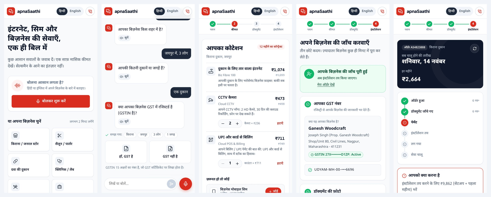
</p>

| | |
|---|---|
| **Demo video (3 min)** | _add link_ |
| **Try it locally** | [Quick start](#quick-start) (about 10 minutes) |
| **Architecture** | [diagram](#architecture) / [`docs/architecture.png`](docs/architecture.png) |
| **Privacy and security note** | [`docs/PRIVACY.md`](docs/PRIVACY.md) (1 page) |
| **Design spec and assumptions** | [`docs/DESIGN.md`](docs/DESIGN.md) |

> All data is synthetic. GSTIN and Udyam lookups run against the case's mock registries, not government systems.
> Payment and installation events are simulated.

---

## Contents

1. [The problem](#the-problem)
2. [What apnaSaathi does](#what-apnasaathi-does)
3. [Screens](#screens)
4. [Architecture](#architecture)
5. [Decisions backed by the data](#decisions-backed-by-the-data)
6. [Quick start](#quick-start)
7. [Try these in the demo](#try-these-in-the-demo)
8. [Tests](#tests)
9. [Privacy and security](#privacy-and-security)
10. [Project structure](#project-structure)
11. [Limits and next steps](#limits-and-next-steps)

---

## The problem

From Accel's own lead data for April to June 2026 (5,000 small-business leads):

| What we found | Number |
|---|---|
| Leads that became customers | **7.4%** (368 of 5,000) |
| Days from lead to activation | **17.6**, with 3 chase calls per customer |
| Acquisition cost per customer | **₹15,053** (₹53,026 for a micro business won by field sales) |
| Acquisition spend on leads that never bought | **64%** |
| Customers activated on a bundle that broke a rule or with an inactive GSTIN | **18%** (68 of 368) |
| Lost leads lost to the process itself (no visit, slow or confusing quote, paperwork, late install) | **1 in 3** (1,611 leads), 2.6x more than were lost to price |

## What apnaSaathi does

One engine, three front doors: a **phone web app** (tap, type or speak), **WhatsApp**, and a **back office** for partners,
sales and KYC staff.

<p align="center">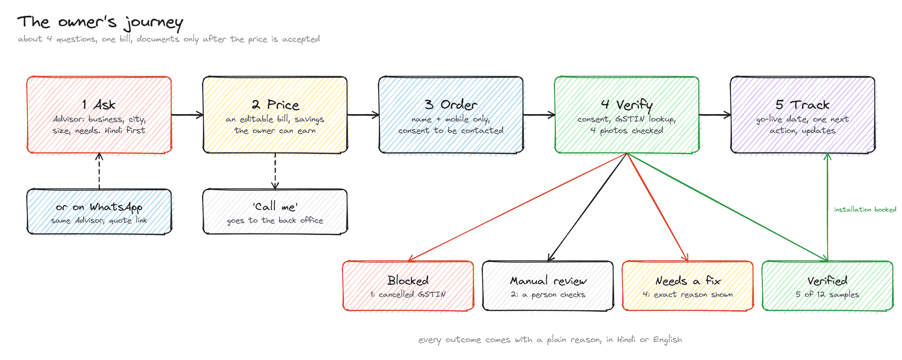</p>

| Step | What happens | Case module |
|---|---|---|
| **1. Ask** | The Advisor asks about four things (business, city, size, needs), in Hindi or English, with picture tiles and voice. | Advisor (GenAI) |
| **2. Price** | A bill the owner can change: items, quantities, savings for a longer contract, 3+ products or autopay. Same price for everyone. | Quote and checkout |
| **3. Order** | Name and mobile only, with consent to be contacted. No documents before this point. | Quote and checkout |
| **4. Verify** | Consent per purpose, GSTIN lookup that fills in the details, 4 photos checked for blur, skew and content, then a verdict with a reason. | Smart KYC |
| **5. Track** | Go-live date, one clear next action (for example, pay), the status of each service, updates in Hindi or English. | Tracker |

Stretch goals from the case, all built: a **WhatsApp** front end (webhook plus an in-app simulator), **voice** in and out,
a **back office** for leads the Advisor could not close, and a **lead score** (propensity model).

## Screens

### On a laptop

| Advisor and live quote | Welcome |
|---|---|
| 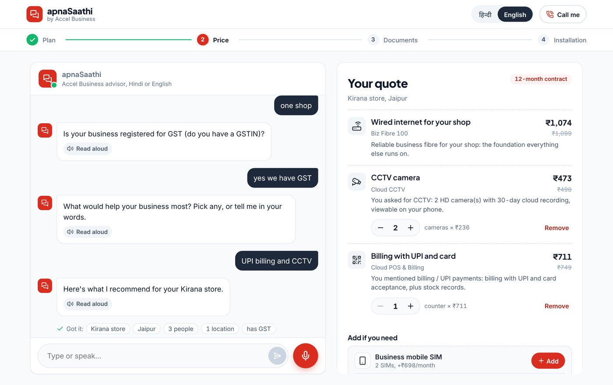 | 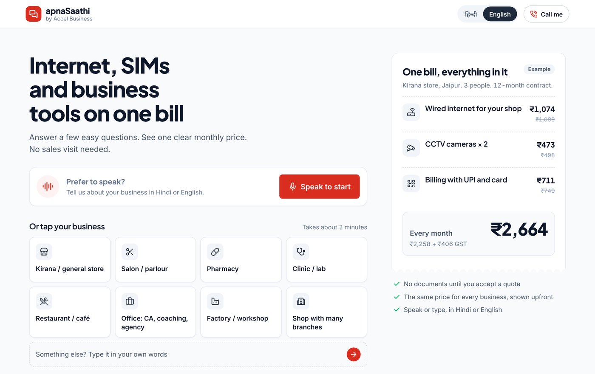 |
| **Smart KYC: verified** | **Smart KYC: needs a fix** |
| 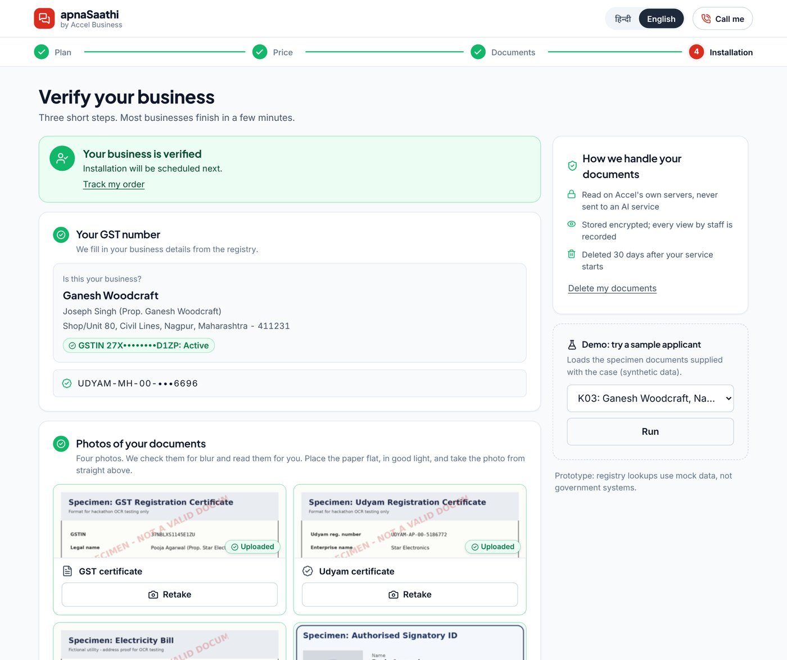 | 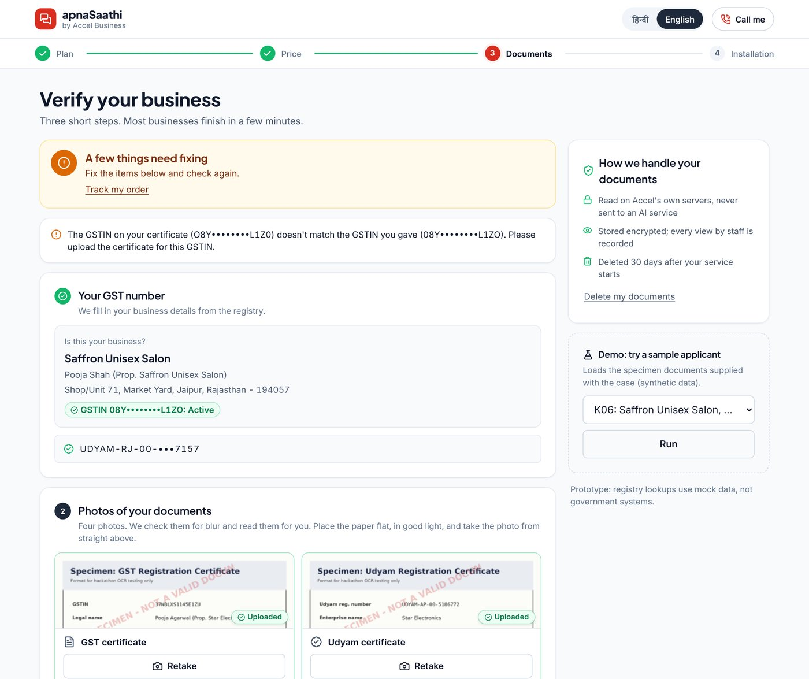 |
| **Order tracker** | **WhatsApp simulator** |
| 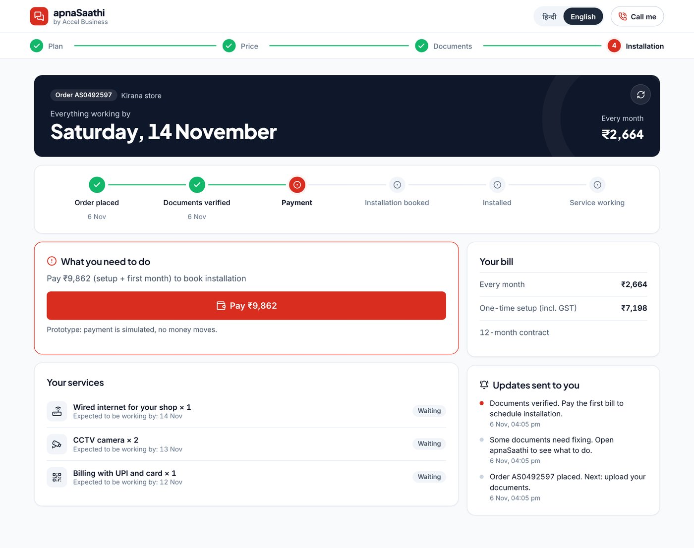 | 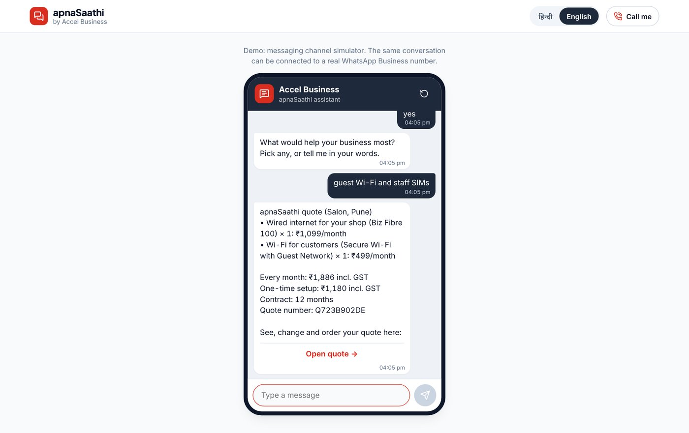 |
| **Back office: leads to call** | **Back office: KYC review** |
| 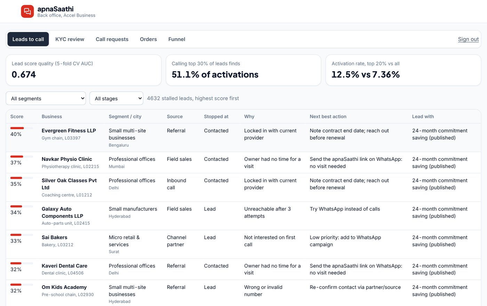 | 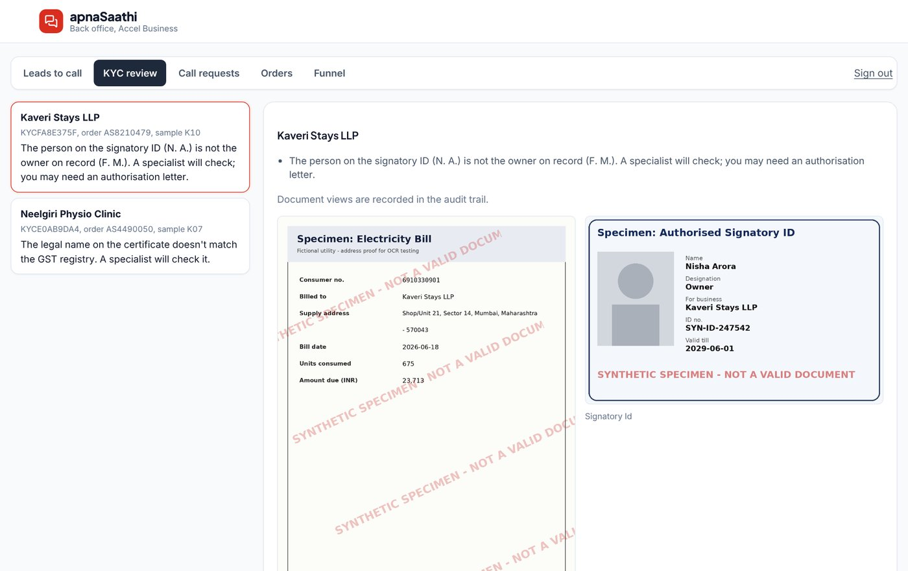 |

### On a phone (Hindi is the default)

| Welcome | Advisor | Quote | KYC | Tracker | WhatsApp |
|---|---|---|---|---|---|
| 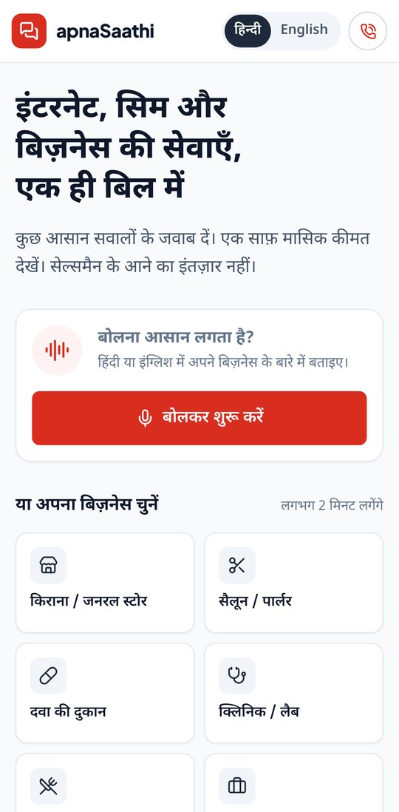 | 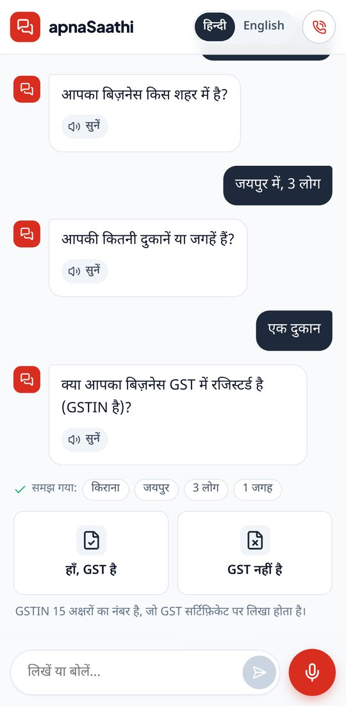 | 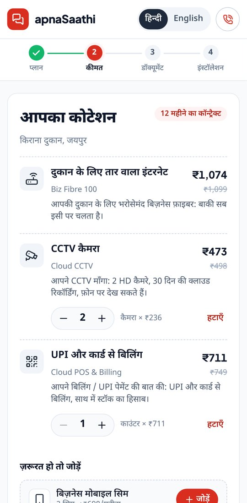 | 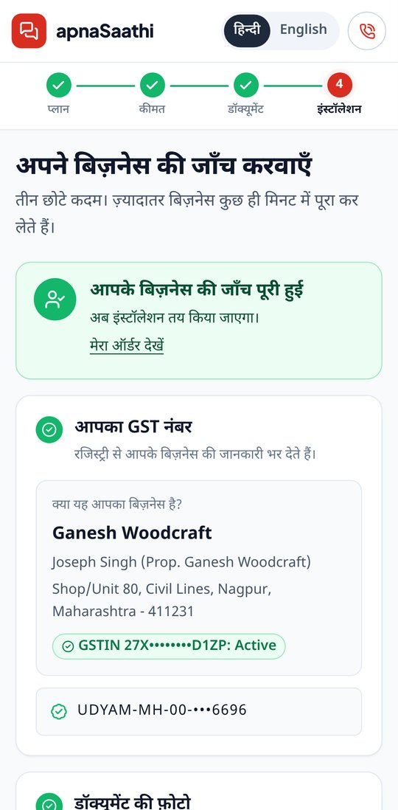 | 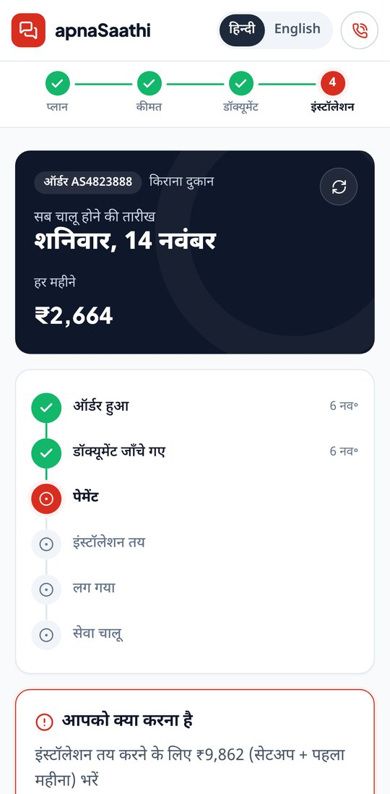 | 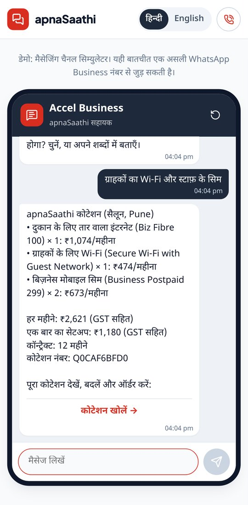 |

## Architecture

<p align="center">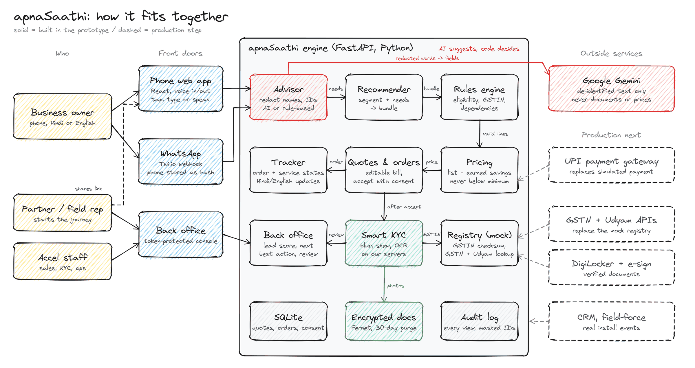</p>

A modular monolith: one FastAPI service holds every module and also serves the built web app, so the whole thing runs
from one address. A more detailed version is in [`docs/architecture-detailed.png`](docs/architecture-detailed.png).

**Principles**

- **AI suggests, code decides.** Gemini only turns the owner's words into structured fields. Prices, eligibility rules and
  KYC decisions are deterministic code. If Gemini is down, a rule-based understanding layer (English, Hindi, Hinglish) and
  a tap-through form keep the journey working.
- **Every rule has a reason.** Each failure carries a code and a plain message in English and Hindi, for the owner and
  for staff.
- **Private by default.** Names and IDs are removed before any text reaches Gemini; documents are read on our own server
  and stored encrypted.

| Layer | Technology |
|---|---|
| Web app | React 19, Vite, TypeScript, plain CSS; Plus Jakarta Sans, Inter, Noto Sans Devanagari; Web Speech API for voice |
| API and engines | Python 3.10+, FastAPI, Pydantic v2 |
| AI | Google Gemini (JSON-schema output, automatic model choice, retry and fallback models) |
| Smart KYC | OpenCV (blur, skew), Tesseract OCR, Fernet encryption |
| Lead score | scikit-learn gradient boosting |
| Data | SQLite (Postgres in production) |
| Messaging | Twilio-compatible WhatsApp webhook |

## Decisions backed by the data

**Who first.** Micro retail and services are 54% of leads but only 30% of customers, with the lowest conversion (4.1%),
the highest cost per customer (₹20,007) and the highest 6-month churn (22.7%). Field sales spends ₹53,026 to win a
customer paying about ₹2,470 a month, so this segment only pays with self-serve. Professional offices come second.
Multi-site chains and manufacturers stay assisted (site survey), using the same quote and KYC.

**What bundle.** The recommender's thresholds come from the 368 real deals. For a typical business in each segment, our
engine's price lands close to what buyers actually paid:

| Segment | Typical bundle (our engine) | Monthly, excl. GST | Buyers paid (median) |
|---|---|---|---|
| Micro retail & services | Biz Fibre 100, 2 business SIMs, POS and billing | ₹2,458 | ₹2,470 |
| Professional offices (14 people) | Biz Fibre 300, 4 SIMs, office suite, security, backup | ₹8,415 | ₹6,575 |
| Small multi-site (8 outlets) | Biz Fibre 300, SIM, 4G/5G backup, POS per outlet | ₹28,268 | ₹28,080 |
| Small manufacturers (85 people) | Leased line, 6 SIMs, office suite and security, firewall, CCTV | ₹21,441 | ₹15,910 |

**Pricing.** List price is the midpoint of the catalogue range. Savings the owner earns move it toward the catalogue
minimum, never below it: 12 extra months of commitment (50% of the gap), 3 or more products (25%), self-serve with
autopay (25%). The weights are labelled assumptions in [`backend/config/pricing.yaml`](backend/config/pricing.yaml).

**Whom to call.** The lead score uses profile and source fields only (5-fold cross-validated AUC 0.674). Calling the top 30%
of scored leads finds 51% of customers.

## Quick start

**You need:** Python 3.10+, Node 20+, and [Tesseract OCR](#tesseract-ocr) for reading documents.

**1. Settings**

```powershell
copy .env.example .env      # macOS/Linux: cp .env.example .env
```

Add a `GEMINI_API_KEY` to `.env` if you have one. Without it, the Advisor uses its rule-based mode; everything else works.

**2. Backend** (Windows PowerShell; on macOS/Linux use `source .venv/bin/activate`)

```powershell
cd backend
python -m venv .venv
.\.venv\Scripts\Activate.ps1
pip install -r requirements.txt
python -m app.db.import_data      # loads the case CSVs into SQLite and checks row counts
python -m pytest                  # 149 tests
```

**3. Web app** (in a second terminal)

```powershell
cd frontend
npm install
npm run build                     # builds into frontend/dist, served by the backend
```

**4. Run**

```powershell
cd backend
uvicorn app.main:app --reload
```

Open **http://localhost:8000**. API docs are at http://localhost:8000/docs.

While changing the UI, run `npm run dev` in `frontend` and open http://localhost:5173 (it forwards `/api` to port 8000).

<a id="tesseract-ocr"></a>
<details>
<summary><b>Tesseract OCR</b></summary>

Documents are read on your own machine; no document is sent to any AI service.

- **Windows:** install the UB Mannheim build (github.com/UB-Mannheim/tesseract/wiki). The default path
  `C:\Program Files\Tesseract-OCR\tesseract.exe` is found automatically; otherwise set `TESSERACT_CMD` in `.env`.
- **macOS:** `brew install tesseract`. **Linux:** `sudo apt install tesseract-ocr`.
- Check: http://localhost:8000/api/kyc/status should show `"ocr_available": true`.
- Without Tesseract the app still runs, but document checks report that OCR is not available and the 12-sample KYC
  tests are skipped.
</details>

<details>
<summary><b>All settings in <code>.env</code></b></summary>

| Variable | What it does | Default |
|---|---|---|
| `GEMINI_API_KEY` | Gemini key for the Advisor (optional) | empty: rule-based mode |
| `GEMINI_MODEL`, `GEMINI_FALLBACK_MODELS` | Force a model; backups if it is overloaded | newest "flash" model |
| `APNASAATHI_TODAY` | "Today" for date-based KYC checks | `2026-07-15` (from the case) |
| `TESSERACT_CMD` | Full path to `tesseract.exe` | found automatically |
| `KYC_ENCRYPTION_KEY` | Key for document encryption | created in `backend/.kyc_key` |
| `KYC_RETENTION_DAYS` | Days before raw photos are deleted | `30` |
| `OPS_TOKEN` | Back-office access token | `accel-demo-ops` |
| `PUBLIC_BASE_URL` | Address used in quote links sent on WhatsApp | `http://localhost:8000` |
| `CHANNEL_HASH_SALT` | Salt for hashing WhatsApp sender numbers | demo value |
| `APNASAATHI_RATE_LIMIT` | `0` turns per-IP rate limits off | `1` |
</details>

## Try these in the demo

| To see | Go to | What to do |
|---|---|---|
| The full journey | http://localhost:8000 | Tap a business (e.g. Kirana), answer by tapping or speaking, change the quote, place the order |
| Smart KYC on real samples | KYC screen, "Demo: try a sample applicant" | Run K01 to K12: K03 is verified, K06 needs a fix (GSTIN mismatch), K07 goes to manual review, K01 is blocked |
| The tracker | "Track my order", or `/#/track/<order id>` | Pay (simulated), then move the order forward from the back office |
| WhatsApp | http://localhost:8000/#/whatsapp | Chat as a shop owner; the plan arrives with a link that opens the quote |
| Back office | http://localhost:8000/#/ops, token `accel-demo-ops` | Leads to call, KYC review, call requests, orders (simulate install events), funnel |
| The Advisor in a terminal | `python -m app.advisor.cli --hi` (from `backend`) | Chat in Hindi; add `--rules` to force rule-based mode |

To connect a real WhatsApp number (optional), point a Twilio WhatsApp sandbox webhook at
`https://<public address>/api/channels/whatsapp` and set `PUBLIC_BASE_URL`.

## Tests

`python -m pytest` in `backend` runs **149 tests**, including:

- **One end-to-end journey** through the API: chat, quote, change, order, KYC, payment, installation, active.
- **All 12 KYC sample applicants** give the expected outcome (5 verified, 4 needs a fix, 2 manual review, 1 blocked).
- **Replaying the 368 real activated deals** through our rules flags exactly the 68 that broke a rule or had an inactive GSTIN.
- GSTIN checksum valid for all 3,534 registry entries; safe 0/O and 1/I corrections only when exactly one valid candidate exists.
- Prices never go below the catalogue minimum; totals and GST add up.
- The Advisor on 15 conversation scenarios, prompt-injection attempts, and Gemini retry and fallback.
- WhatsApp webhook (sender stored only as a hash), security headers, rate limits and size limits.

## Privacy and security

Short version (full note: [`docs/PRIVACY.md`](docs/PRIVACY.md)):

- **Documents only after a price is accepted**; consent per purpose with a versioned notice; the owner can delete documents at any time.
- **Photos are read on our own server** (Tesseract, OpenCV) and never sent to an AI service.
- **Gemini sees de-identified text only**: names, phone numbers, GSTIN, Udyam, PAN, email and pincode are replaced first.
- **Encrypted at rest**, IDs masked in screens and logs, **every document view audited**, raw photos **deleted 30 days** after the case closes.
- Content-Security-Policy and other security headers, per-IP rate limits, an 8 MB request cap; no secrets in the repository.

## Project structure

```
apnasaathi/
├── backend/
│   ├── app/
│   │   ├── advisor/        dialogue, Gemini adapter, rule-based understanding, PII redaction
│   │   ├── recommender/    segment + needs -> bundle
│   │   ├── rules/          eligibility and bundle rules, reason codes (EN/HI)
│   │   ├── pricing/        list price, earned savings, GST
│   │   ├── quotes/         editable quotes, change log, share text
│   │   ├── orders/         orders, tracker, simulated events, notifications
│   │   ├── kyc/            image checks, OCR, extraction, checks, encrypted storage, consent
│   │   ├── registry/       GSTIN checksum, mock GSTN and Udyam lookup
│   │   ├── backoffice/     lead score, next best action, offers, KYC review, funnel
│   │   ├── channels/       WhatsApp webhook
│   │   ├── api/            HTTP routes
│   │   ├── security.py     headers, rate limits, size cap
│   │   └── main.py         app entry point; also serves the built web app
│   ├── config/             pricing.yaml, offers.yaml (labelled assumptions)
│   ├── data/               case dataset (synthetic) and 12 KYC sample applicants
│   └── tests/              149 tests
├── frontend/src/           React app: Advisor, quote, checkout, KYC, tracker, back office, WhatsApp simulator
└── docs/                   architecture, journey, privacy note, design spec, screenshots
```

## Limits and next steps

**In this prototype:** registry lookups use the case's mock files; payment and installation events are simulated; the
WhatsApp front end runs in a simulator (a real Twilio sandbox can be connected); the Advisor speaks Hindi and English.

**Next, for production:**

- Live GSTN and Udyam APIs; **DigiLocker** document fetch and **Aadhaar e-sign**; KYC for each SIM user, as DoT requires.
- UPI autopay through a payment gateway; CRM, provisioning and field-force integration for real installation events.
- Marathi, Kannada, Gujarati, Tamil and Telugu (34% of leads prefer a regional language).
- A partner dashboard (quotes already carry a partner code), Postgres, and cloud KMS for document keys.
