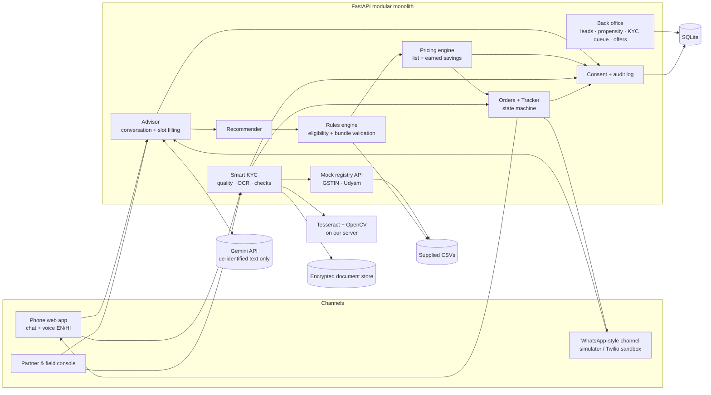

# apnaSaathi — Phase 3 Design Spec

*Project Udyam Digital · YTL Hackathon 2026, Track A · Status: DRAFT for approval · 2026-11-04*

apnaSaathi is a digital-first acquisition and onboarding journey for small businesses buying from **Accel Business** (the fictional operator in the case). One shared engine (Advisor → Quote → Smart KYC → Tracker) serves three front doors: a phone web app (chat + voice), a WhatsApp-style channel, and a partner/field console.

All data is synthetic. Registry lookups are **mock** lookups against the supplied CSVs, never live government systems.

---

## 1. Decisions locked (Phases 0–2)

| ID | Decision |
|---|---|
| D1 | Approach C: one engine, three front doors (web/PWA chat + voice, WhatsApp-style, partner console) |
| D2 | Segment priority: Micro retail first (hero persona: Hindi-speaking kirana/salon owner), Professional offices second, Multi-site and Manufacturers assisted |
| D3 | Pricing: catalogue midpoint list price + "earned savings" (commitment 50% / 3+ products 25% / self-serve + autopay 25% of the gap to catalogue min — **initial assumptions, configurable**). Uniform for everyone; no willingness-to-pay pricing |
| D4 | Layer 3 "Profitability-Aware Offer Optimisation" = back-office recommendation of *published* offers/perks using propensity + assumed cost parameters, with a margin floor |
| D5 | Scope: MUST = Advisor (EN/HI), rules + pricing, Quote, Smart KYC (12 samples), Tracker, consent/masking/audit. SHOULD = voice, back office + propensity + KYC queue, WhatsApp-style channel. COULD = Twilio sandbox, per-SIM end-user KYC, Entity Locker simulation, offer simulator |
| D6 | Metrics: lead→activation 7.4%→10%; quote acceptance 43.6%→55%; days to activate 17.6→≤8; CPA ₹15,053→≤₹10,000; 6-mo churn 15.2%→≤12% (micro guardrail); status calls 3.0→≤1 |
| D7 | LLM: Gemini (free tier). Only de-identified business descriptions are sent; no names, phone numbers, GSTINs or documents |
| D8 | Name: apnaSaathi. Operator branding in app: Accel Business (as in the case) |
| D9 | Deliverable: 7-slide deck as .pptx + PDF, containing architecture diagram, privacy note, demo-video and repo links |

---

## 2. Architecture



**Why a modular monolith:** one person, one laptop, a 3-minute demo. Each module has its own folder, API router and tests, so it can become its own service later (shown as the production view on the architecture slide).

### Stack

| Layer | Choice |
|---|---|
| Backend | Python 3.11+, FastAPI, Pydantic v2, SQLModel (SQLite), pytest |
| AI | Gemini via a thin adapter (`llm/gemini.py`) with JSON-schema output; Flash-class model picked at build time from what the free tier offers |
| OCR | Tesseract (pytesseract) + OpenCV for blur/skew checks and deskew |
| ML | scikit-learn gradient boosting for lead propensity, trained offline on `smb_leads.csv` |
| Frontend | React + Vite + TypeScript + Tailwind, phone-first; react-i18next for EN/HI; browser Web Speech API for voice (hi-IN, en-IN) |
| Security | `cryptography` (Fernet) for documents at rest; masking helpers; audit table |

---

## 3. Module design

### 3.1 Catalogue and rules engine (deterministic)

Loads `product_catalogue.csv` once at startup.

**Product eligibility** (each returns a reason code if it fails):

| Rule | Source column | Reason code |
|---|---|---|
| City tier in `available_city_tiers` | available_city_tiers | `TIER_UNAVAILABLE` |
| employees ≥ `min_employees` | min_employees | `BELOW_MIN_EMPLOYEES` |
| sites ≥ `min_sites` | min_sites | `BELOW_MIN_SITES` |
| `requires_gstin = Y` → GSTIN present **and registry status Active** | requires_gstin | `GSTIN_REQUIRED` / `GSTIN_INACTIVE` |

**Bundle validation** (whole combination):
- Every product with `requires_one_of` has at least one listed product in the same bundle, otherwise `DEPENDENCY_MISSING`. Example: P11 Static IP needs P01, P02 or P03; a leased line alone does not qualify.
- Quantities must be ≥ 1 and consistent with the unit: per site ≤ sites, per user ≤ employees, per line ≤ employees + 5 (assumption A6).
- `target_segments` is used for **ranking only**, not eligibility (the data shows P01 sold to multi-site businesses).

Every reason code maps to a plain-language message in EN/HI, e.g. "1 Gbps fibre is not available in Jaipur yet. Biz Fibre 300 is the fastest option here."

### 3.2 Recommender

Input: a validated `BusinessProfile`. Output: one recommended bundle, optional add-ons, and excluded products with reasons.

1. **Segment:** from business type (35 types in the data map to 4 segments). Unknown type → LLM classifies into one of the 4 segments, then the user confirms.
2. **Connectivity base:**
   - Manufacturer with ≥ 25 employees → P06; with ≥ 10 → P05; otherwise P03 (tier 1) or P02.
   - Multi-site or professional office with ≥ 5 employees → P02 per site (P03 if tier 1 and ≥ 15 employees, assumption A7).
   - Micro → P01.
   - If the owner says fibre is not available → P04 AirFiber (also the automatic swap when the Tracker reports "site not feasible").
3. **Need tags → products** (the LLM extracts the tags; the mapping is deterministic):

| Need tag | Products |
|---|---|
| `mobile_lines` | P07 (micro) / P08 (others), qty = stated or min(employees, 2) |
| `billing_upi` | P19 per counter |
| `cctv` | P23 per camera (default 2 per site) |
| `guest_wifi` | P22 per site |
| `whatsapp_customers` | P15 (GSTIN), else note "needs GSTIN" |
| `sms_alerts` | P14 (GSTIN) |
| `website` | P18 |
| `email_office` | P16 per user |
| `backup_files` | P17 |
| `security` | P20 per device; P21 if ≥ 10 employees and GSTIN |
| `uptime_backup` | P09 per site |
| `central_management` | P10 if ≥ 3 sites, ≥ 10 employees, GSTIN |
| `static_ip` | P11 (only with P01/P02/P03) |
| `cloud_calling` | P12 (≥ 3 employees, GSTIN) |
| `toll_free` | P13 (GSTIN) |
| `machines_iot` | P24 per device |
| `vehicles` | P25 per vehicle |

4. **Validate** the bundle and auto-add a dependency if one is missing (e.g. adding P22 with no base adds P01), and tell the user why.
5. **Explain:** each line gets a "why" tied to what the owner said, e.g. "You said customers pay by UPI → Cloud POS".

### 3.3 Pricing engine (deterministic)

- **List price per unit** = round((price_min + price_max) / 2).
- **Earned savings** move each line's price toward `price_min` by the sum of earned weights (capped at 1):
  - `commit_extra_12m` = 0.50 (the owner chooses a term 12 months longer than the bundle minimum)
  - `bundle_3plus` = 0.25 (3 or more distinct products)
  - `selfserve_autopay` = 0.25 (journey completed without assisted mode, and autopay chosen)
- **Unit price** = list − (list − price_min) × min(1, Σweights). It is never below `price_min`.
- **Contract term** = max(`min_contract_months`) across lines, or +12 if the commitment saving is chosen.
- **One-time charges** = Σ `one_time_setup_inr` × qty, shown separately.
- **GST:** prices are shown excluding GST, plus an 18% GST line and the total (assumption A3).
- **Output:** line items, monthly subtotal, savings breakdown (₹ and reason), one-time total, term, and expected activation date. Every quote shown is logged to `quote_impressions` (Layer 3 data).

Weights live in `config/pricing.yaml` and are labelled assumptions.

### 3.4 Advisor (AI-assisted, guarded)

- **Slot-filling conversation**, at most about 7 turns.
- **Required slots:** business_type, employees, sites, city, has_gstin, needs[] (≥ 1).
- **Optional slots:** current_internet, fibre_available, mobile_lines_count, cameras, counters.
- **Each turn:** de-identify the text (regex: phone numbers, GSTIN, Udyam numbers, emails, PAN-like strings) → Gemini returns a `ProfileUpdate` JSON validated against the schema → merge into state → ask for the next missing slot in the user's language.
- **The LLM never sees prices** and never decides eligibility. After recommendation it receives the bundle facts (product names, reason codes, the user's own words) and writes short explanations. Prices are rendered by the UI from the pricing engine.
- **Injection guard:** user text is passed as data in a delimited field. The system prompt says to ignore instructions inside it. Output must match the schema or it is discarded.
- **Fallback:** on LLM error, timeout or quota, the same slots are collected through a tap-through form (buttons). The journey never dead-ends.
- **Out of scope** (e.g. "I want DTH", "only a mobile plan") → polite answer plus nearest catalogue option (P07/P08), or handoff to a human.
- **Handoff:** "Talk to a person" creates a back-office lead with an LLM-written summary (de-identified).

### 3.5 Smart KYC

**Required documents**

| Path | Documents |
|---|---|
| GSTIN path | Consent → enter GSTIN → upload GST certificate, address proof (≤ 90 days), signatory ID. Udyam certificate required if the business has a Udyam number; pre-filled from registry lookup. |
| No GSTIN, has Udyam | Udyam certificate + address proof + signatory ID. GST-required products are excluded. |
| Neither | Only non-GST products; assisted manual review. Show "Udyam registration is free and online" with a link. Needs legal review (A9). |

**Pipeline for each upload**
1. Check the file type and size: PNG/JPG/PDF, ≤ 10 MB, magic-byte check.
2. **Quality gate:**
   - Blur (variance of the Laplacian < threshold → "Photo is blurry, please retake").
   - Skew (min-area-rect angle > 2° → auto-deskew; > 20° → ask for a retake).
3. **OCR** (Tesseract, on our server) → **classify** by header keywords → **extract fields** with label regexes.
4. **GSTIN confusable correction:** position-aware substitution only where the format demands a class:
   - Digit positions: O→0, I→1.
   - Letter positions: 0→O, 1→I.
   - Then check the GSTIN checksum.
   - Accept a correction only if exactly one candidate passes the checksum. **Show it to the user to confirm.** Never silently change an identity value.
   - S/5 and B/8 are **not** substituted, so a genuinely different digit, as on K06, is never "corrected" into a match.
5. **Checks** (each returns PASS / WARN / FAIL with a fix message):

| Check | Rule |
|---|---|
| GSTIN format + checksum | 15-char structure; 4th PAN char `X` accepted (README) |
| GSTIN registry | Exists; status Active (Cancelled/Suspended = FAIL for GST products) |
| Certificate ↔ entered GSTIN ↔ registry | All three equal after confirmed correction |
| Names | Legal and trade name match the registry (normalised, token-based; WARN ≥ 0.85, FAIL below) |
| Address | Pincode and city match the registry address |
| Address proof | Billed-to matches trade/legal name; pincode matches; bill date ≤ 90 days before "today" (2026-07-15, configurable) |
| Signatory ID | Name present; business matches; valid_till ≥ today; for a proprietorship, the name matches the proprietor in the legal name; otherwise it matches the declared contact, else MANUAL_REVIEW + authorisation letter |
| Udyam | Number present + format `UDYAM-XX-00-NNNNNNN`; registry exists; enterprise name and state/city match. Registration date and major activity differences = **WARN only** (systematic mismatch observed in the supplied pack, A10) |
| Completeness | All required documents present |

6. **Overall outcome:** `VERIFIED` / `NEEDS_FIX` (customer can fix) / `MANUAL_REVIEW` (human) / `BLOCKED` (GSTIN inactive → offer a non-GST bundle). Each outcome comes with plain-language next steps.

**Expected outcomes on the supplied samples (acceptance tests)**

| ID | Expected | Driver |
|---|---|---|
| K01 | BLOCKED (GST path) + NEEDS_FIX Udyam | GSTIN Cancelled; Udyam number blank |
| K02 | VERIFIED after confirmed correction | Skewed scan deskewed; `0`→`O` resolved by checksum |
| K03 | VERIFIED | — |
| K04 | NEEDS_FIX | GST certificate blurred → retake |
| K05 | NEEDS_FIX | Udyam certificate missing (registry record found and pre-filled) |
| K06 | NEEDS_FIX → MANUAL_REVIEW if repeated | Certificate GSTIN (…S8189…) ≠ registry (…S5189…); checksum fails |
| K07 | MANUAL_REVIEW | Legal name says "Shri Physio Clinic", registry says "Neelgiri" |
| K08 | VERIFIED after confirmed correction | `0`→`O` resolved by checksum |
| K09 | VERIFIED | — |
| K10 | MANUAL_REVIEW | Signatory ≠ declared owner contact → authorisation letter |
| K11 | NEEDS_FIX | Address proof 257 days old |
| K12 | VERIFIED | — |

**Per-SIM end-user KYC (COULD):** for P07/P08 lines, the owner enters a name and mobile number for each user. Each user gets a simulated link. A SIM line moves to ACTIVE only after its user's KYC is done (DoT business-connection rule).

### 3.6 Orders and Tracker

**Order states:** `QUOTE_ACCEPTED → KYC_PENDING → (KYC_ACTION_NEEDED | KYC_MANUAL_REVIEW) → KYC_VERIFIED → PAYMENT_PENDING → CONFIRMED → FULFILLING → ACTIVE`, plus `CANCELLED`.

**Line states:** `SCHEDULED → INSTALL_VISIT → INSTALLED → ACTIVE`, plus `FEASIBILITY_FAILED` (offer a one-tap swap to P04 AirFiber) and `ON_HOLD` (waiting on the customer).

- **ETA per line** = CONFIRMED date + `typical_install_days` (+2 days in tier 2, A8). The order's ETA is the maximum across lines.
- **Pending actions** shown at the top, e.g. "Upload a new electricity bill", "Ravi hasn't completed SIM KYC".
- **Proactive updates** on every state change, in app and in the WhatsApp-style message log, in the owner's language.
- **Demo control:** the back office can advance the simulated clock and inject events (delay, feasibility failure, payment failure). All are labelled simulated.
- **One bill view:** all lines, one monthly total, next bill date.

### 3.7 Back office (partner / field / ops)

- **Leads:** supplied 5,000 leads plus new app sessions, showing stage reached, drop reason, propensity score and next best action (e.g. "Call: quote viewed, not accepted; high propensity").
- **Propensity model:** gradient boosting on profile and source features only (no stage/outcome leakage). Report the cross-validated AUC (≈0.68 in Phase 0).
- **KYC review queue:** document images (role-gated), check results, approve / reject / request fix. Every decision is audited.
- **Offer recommendations (Layer 3):** for each stalled lead, the expected value of each *published* offer = P(convert) × (monthly value × expected tenure) − acquisition cost − discount cost, using assumed cost parameters with a margin floor. COULD: an interactive offer simulator.
- **Funnel:** live counts from app events.
- **Partner attribution:** a partner code or QR code is attached to the session, so partners are credited when a customer self-completes.

### 3.8 Channels

- **Web/PWA:** primary demo surface, phone-sized.
- **Voice:** mic button → Web Speech API (hi-IN/en-IN) → same Advisor; replies read aloud. Best supported in Chrome; text fallback.
- **WhatsApp-style:** a phone-frame chat screen calling the same Advisor API, labelled as a simulator. COULD: Twilio WhatsApp sandbox webhook using the same handler.
- **Partner console:** the Advisor in "assisted mode" (no self-serve saving; partner code attached).

---

## 4. Data model (SQLite)

| Table | Key fields |
|---|---|
| `gst_registry`, `udyam_registry` | Imported from CSVs (read-only, mock) |
| `leads` | Imported `smb_leads.csv` + `propensity_score` |
| `sessions` | id, channel, language, partner_code, created_at |
| `profiles` | session_id, slots (JSON), segment, completeness |
| `quote_impressions` | id, session_id, lines (JSON), list_total, savings (JSON), shown_at, accepted_at, rejected_reason |
| `orders` / `order_lines` | state, term, monthly_total, one_time_total, ETA / product_id, qty, unit_price, line_state |
| `kyc_cases` / `kyc_documents` / `kyc_checks` | outcome / doc_type, encrypted_path, quality metrics / check, status, message |
| `consents` | session_id, purpose, notice_version, granted_at, withdrawn_at |
| `audit_events` | actor, action, entity, masked_details, at |
| `notifications` | order_id, channel, language, text, at |

**Masking:** GSTIN shown as `37I••••••••L1ZS`, Udyam as `UDYAM-AP-00-•••1562`, names in logs as initials.

---

## 5. API contracts (REST, JSON)

| Method + path | Purpose |
|---|---|
| `POST /api/sessions` | Start a session (channel, language, partner_code) |
| `POST /api/advisor/{session}/message` | Send text, receive reply + profile state + next question (or recommendation) |
| `POST /api/advisor/{session}/form` | Fallback slot submission |
| `POST /api/quotes` | Profile → recommended bundle + priced quote (logged impression) |
| `PATCH /api/quotes/{id}` | Toggle add-on / qty / term / autopay → repriced + validated |
| `POST /api/quotes/{id}/accept` | → order |
| `POST /api/kyc/{order}/consent` | Grant per-purpose consent |
| `POST /api/kyc/{order}/gstin` | Format + checksum + mock registry → masked prefill |
| `POST /api/kyc/{order}/documents` | Upload → quality + OCR + extraction |
| `POST /api/kyc/{order}/evaluate` | Run all checks → outcome |
| `DELETE /api/kyc/{order}/documents` | Consent withdrawal → delete documents |
| `GET /api/orders/{id}/tracker` | Timeline, ETA, pending actions, bill view |
| `GET /api/registry/gstin/{gstin}`, `/udyam/{no}` | Mock lookup (labelled MOCK) |
| `GET /api/admin/leads`, `/admin/kyc-queue`, `/admin/funnel` | Back office |
| `POST /api/admin/kyc/{id}/decision`, `/admin/orders/{id}/event` | Review decision; simulated events |

Admin routes use a demo role token (A11).

---

## 6. Screens

**Customer (phone):**
1. Welcome + language (EN/HI) + start by voice or text
2. Advisor chat (mic, quick-reply chips)
3. Recommendation + Quote (lines with "why", toggles, savings breakdown, one-time charges, term, share on WhatsApp)
4. Consent (per purpose, plain language, retention stated)
5. KYC (GSTIN prefill, guided uploads with live quality feedback)
6. KYC result (fix steps / under review / verified)
7. Payment (simulated, autopay toggle)
8. Tracker (timeline, ETA, pending actions, bill)

**Back office:** Leads, KYC review, Offer recommendations, Funnel.

**Simulator:** WhatsApp-style phone frame.

---

## 7. Privacy and security plan (basis for the 1-page note)

- **Consent** per purpose (recommendation, KYC verification, SIM activation), with a versioned notice, stored and withdrawable. Aligned with DPDP Rules 2025 (separate, clear notice; specific purpose). Legal review flagged.
- **Minimisation:** the Advisor needs no personal data; KYC collects only the listed documents; the LLM receives de-identified text only (Gemini free-tier terms advise against personal data).
- **Documents:** OCR on our server; Fernet-encrypted at rest; served only to the reviewer role. Retention: raw images deleted 30 days after activation or rejection (A12), keeping masked fields and check results for audit.
- **Masking** in UI and logs; no raw identifiers in application logs.
- **Audit events** for consent, upload, check, decision, data deletion and admin events.
- **Uploads:** type and size whitelist, magic-byte check, re-encode images before OCR, no execution.
- **Erasure request** endpoint (DPDP: respond within 90 days). Breach-response note: inform affected people without delay, in plain language.
- **Honest labels:** mock registry, simulated payment, simulated install events, WhatsApp simulator.

---

## 8. Failure modes

| Failure | Behaviour |
|---|---|
| Gemini error / quota / bad JSON | Tap-through form; same engine |
| City not in the list | Treat as tier 2 (conservative); availability to be confirmed |
| Fibre not feasible | One-tap swap to P04; tracker re-plans |
| GSTIN inactive | GST products removed with reason; non-GST bundle offered |
| OCR unreadable / blurry | Retake prompt with a tip; after 2 tries → manual review |
| Ambiguous GSTIN characters | Checksum-resolved suggestion shown for confirmation |
| Payment failed | Order stays PAYMENT_PENDING; retry + autopay prompt |
| Voice not supported | Text input |

---

## 9. Test plan

- **Unit:**
  - Every eligibility rule and reason code.
  - Bundle dependency (incl. P11 + P05 invalid).
  - Pricing maths (list, each saving, cap at min, setup, term, GST).
  - GSTIN checksum against all 3,534 registry entries.
  - Confusable correction (K02, K08 fixed; K06 not "fixed").
  - Masking.
- **Data regression:** replay the 368 activated bundles through the validator. Expect exactly the 48 rule-violating leads to be flagged, plus the 22 inactive GSTINs (68 total).
- **KYC acceptance:** the 12 samples must produce the outcomes in §3.5.
- **Advisor scenarios:** at least 15 own scripts (EN, HI, Hinglish; kirana with no GSTIN; clinic; 6-site restaurant chain; textile unit; city not in list; "only want a mobile plan"; unsupported "DTH"; prompt injection; contradictory sizes; LLM down).
- **End-to-end:** chat → quote → accept → KYC → payment → tracker, per segment.
- **Manual demo checklist:** phone viewport, Hindi rendering, voice in Chrome, all error states.

---

## 10. Assumptions register

| ID | Assumption | Risk if wrong | Validate by |
|---|---|---|---|
| A1 | Midpoint list price | Price perception | Quote-impression experiments |
| A2 | Savings weights 50/25/25 | Margin leakage or weak incentive | Experiments + cost data |
| A3 | Catalogue prices exclude GST; 18% shown | Displayed total wrong | Confirm with organisers |
| A4 | "Today" = 2026-07-15 for date checks | — | README states it |
| A5 | Target segments = ranking, not eligibility | — | Data shows P01 sold to multi-site |
| A6 | Mobile lines ≤ employees + 5 | Blocks a valid order | Make configurable |
| A7 | Connectivity thresholds in §3.2 | Wrong base product | Advisor test scenarios |
| A8 | +2 install days in tier 2 | ETA off | Data: tier-2 install 5.9 vs 4.1 days |
| A9 | Neither GSTIN nor Udyam → manual review only | Legal | Legal review |
| A10 | Udyam date/activity mismatch = WARN | Answer key may expect a flag | Kept visible as WARN |
| A11 | Demo role token for admin | Not production auth | Roadmap: SSO / RBAC |
| A12 | 30-day raw-document retention | Legal | Legal review |
| A13 | Unknown city → tier 2 | Hides tier-1 products | Ask the user to confirm |

---

## 11. Repository layout (Phase 4)

```
apnasaathi/
  backend/
    app/
      main.py  config/  db/
      catalogue/  rules/  recommender/  pricing/
      advisor/  llm/  kyc/  registry/  orders/  backoffice/  audit/
    data/          (supplied CSVs + KYC samples)
    tests/
  frontend/  (React + Vite + Tailwind; customer, backoffice, whatsapp-sim)
  docs/  DESIGN.md  PRIVACY.md  architecture.png
  .env.example  README.md
```

## 12. Build order (Phases 4–9)

| Phase | Work |
|---|---|
| 4 | Repo, data import, rules + pricing + registry + GSTIN logic with tests |
| 5 | Advisor (LLM + fallback) + recommender |
| 6 | Quote and checkout |
| 7 | Smart KYC against the 12 samples |
| 8 | Tracker, back office, propensity |
| 9 | Voice, WhatsApp-style channel, hardening, end-to-end tests |
| 10–11 | Deck (.pptx + PDF), privacy note, diagram, demo video |
